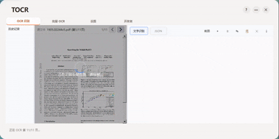
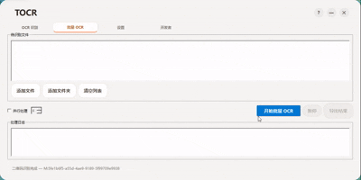
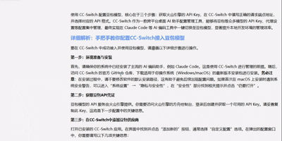
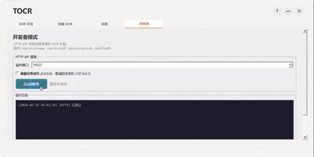

# TurboOCR

<div align="center">

**🚀 极速、智能、开箱即用的 Windows 离线 OCR 工具**

基于 PP-OCRv6 + Paddle Inference，无需联网，GPU 加速，毫秒级响应

[](LICENSE)
[]()

[English](README_EN.md)

</div>

---

## 📸 预览

| 普通 OCR | 批量 OCR |
|:---:|:---:|
|  |  |

| 后台 OCR | HTTP 服务模式 |
|:---:|:---:|
|  |  |

## ✨ 特性

- **🎯 三档模型，按需切换** — tiny (~6MB)、small (~31MB)、medium (~138MB)，覆盖速度与精度需求
- **⚡ GPU 加速** — Paddle Inference + CUDA/cuDNN 自动检测，不兼容时自动降级 CPU
- **🖥️ 离线运行** — 全部本地推理，无需联网，数据安全
- **📋 多模式 OCR**
  - **截图 OCR** — 全局热键 (Ctrl+Q) 框选，毫秒级识别
  - **批量 OCR** — 多文件并行处理，支持图片/PDF
  - **后台 OCR** — 静默识别，结果自动复制到剪贴板，带托盘通知
  - **剪贴板 OCR** — 监听剪贴板图片，自动触发识别
- **📄 PDF 支持** — 内置渲染引擎，多页并行 OCR
- **📝 智能排版** — 8 种解析器（单段、多段、代码块、竖排等）
- **🌐 HTTP API** — 内置 REST 服务（3 个端点），支持跨语言调用
- **📊 历史记录** — SQLite 持久化，缩略图 + 原图 + 多页数据，点击回溯
- **🎨 深色主题** — 完整的 Dark Mode 支持
- **🔍 二维码/条形码** — ZXing + OpenCV 快速预检，自动识别
- **🌍 多语言** — 运行时翻译系统，支持中/英切换

## 📦 直接下载

> 前往 [Releases](https://github.com/lazyboooooy/TurboOCR/releases) 下载预编译版本，解压即用，无需安装 VC++ Redistributable。

## 🔧 从源码构建

### 环境要求

| 工具 | 版本 | 说明 |
|:---|:---|:---|
| Visual Studio | 2022+ (v142/v143/v145) | MSVC 工具链 |
| CMake | 3.16+ | 构建系统 |
| Qt | 6.8.3 msvc2022_64 | GUI 框架 |
| Python | 3.8+ | 运行依赖下载脚本 |

### 构建步骤

```bash
# 1. 下载预编译依赖 (3rdparty/ + models/, 约 3.4GB)
python setup_deps.py

# 2. 配置 CMake
cmake -B build -DCMAKE_PREFIX_PATH="D:/Qt/6.8.3/msvc2022_64"

# 3. 编译
cmake --build build --config Release

# 4. 运行
./build/Release/TurboOCR.exe
```

> **注意**: 需要从 VS Developer Command Prompt 运行，确保 MSVC 工具链在 PATH 中。

### 依赖说明

`3rdparty/`（第三方库）和 `models/`（OCR 模型）是预编译的二进制包，**不在 Git 仓库中**。`setup_deps.py` 会自动从 [GitHub Releases](https://github.com/lazyboooooy/TurboOCR/releases) 下载对应版本的 `deps.zip` 并解压到项目根目录。

若网络受限，也可手动下载 Release 中的 `deps.zip`，然后运行：
```bash
python setup_deps.py --local deps.zip
```

## 🏗️ 项目架构

```
TurboOCR/
├── src/
│   ├── main.cpp                入口 (单实例锁)
│   ├── main_window.h/.cpp      主窗口 (无边框、托盘、热键、剪贴板)
│   ├── ocr/engine.h/.cpp       OCR 引擎封装
│   ├── core/
│   │   ├── config_manager      INI 配置 + 模型尺寸持久化
│   │   ├── logger              日志系统
│   │   ├── ocr_history         SQLite 历史记录
│   │   ├── pdf_render          PDF → PNG 渲染
│   │   ├── screen_capture      全屏框选截图
│   │   ├── gpu_checker         GPU/CUDA/cuDNN 兼容检测
│   │   ├── qrcode_scanner      二维码/条形码扫描
│   │   ├── http_server         REST API 服务
│   │   ├── theme               主题管理系统
│   │   └── i18n                国际化
│   ├── pages/
│   │   ├── calligraphy_ocr_page  主 OCR 页面
│   │   ├── batch_page            批量 OCR
│   │   ├── settings_page         设置页
│   │   └── developer_page        API + 日志控制台
│   ├── postprocess/parsers     8 种文本解析器
│   └── output/formatters       导出格式化
├── ocr_engine/                 PaddleOCR C++ 引擎
├── models/                     PP-OCRv6 模型文件
└── resources/                  图标、翻译
```

## 📄 第三方库许可

本项目基于以下开源项目构建，感谢所有贡献者：

| 库 | 版本 | 许可 | 用途 |
|:---|:---|:---|:---|
| [PaddlePaddle](https://github.com/PaddlePaddle/Paddle) | 3.0.0 | Apache 2.0 | OCR 推理引擎 |
| [OpenCV](https://github.com/opencv/opencv) | 3.4.10 | Apache 2.0 | 图像处理 |
| [Qt](https://www.qt.io/) | 6.8.3 | LGPLv3 | GUI 框架 |
| [ZXing-C++](https://github.com/nu-book/zxing-cpp) | 2.2.1 | Apache 2.0 | 二维码扫描 |
| [Protobuf](https://github.com/protocolbuffers/protobuf) | - | BSD 3-Clause | 模型序列化 |
| [gflags](https://github.com/gflags/gflags) | - | BSD 3-Clause | 命令行解析 |
| [glog](https://github.com/google/glog) | - | BSD 3-Clause | 日志 |
| [Abseil](https://github.com/abseil/abseil-cpp) | - | Apache 2.0 | C++ 基础库 |
| [oneDNN](https://github.com/oneapi-src/oneDNN) | - | Apache 2.0 | 深度学习加速 |
| [nlohmann/json](https://github.com/nlohmann/json) | - | MIT | JSON 解析 |
| [yaml-cpp](https://github.com/jbeder/yaml-cpp) | - | MIT | YAML 解析 |
| [zlib](https://github.com/madler/zlib) | - | zlib License | 压缩 |
| [Clipper](http://www.angusj.com/delphi/clipper.php) | - | BSL 1.0 | 多边形裁剪 |
| [xxHash](https://github.com/Cyan4973/xxHash) | - | BSD 2-Clause | 快速哈希 |

## 🤝 参与贡献

Contributions are welcome! 请遵循以下流程：

1. Fork 本仓库
2. 创建特性分支 (`git checkout -b feature/amazing-feature`)
3. 提交更改 (`git commit -m 'Add amazing feature'`)
4. 推送到分支 (`git push origin feature/amazing-feature`)
5. 创建 Pull Request

## ⚠️ 免责声明

本工具仅供学习和合法用途使用。请勿将 TurboOCR 用于任何侵犯他人权益的场景。

## 📄 许可

TurboOCR 基于 [Apache License 2.0](LICENSE) 开源。

Copyright © 2026 TurboOCR Contributors
