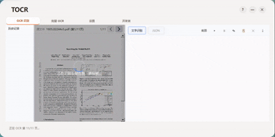
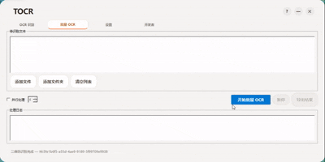
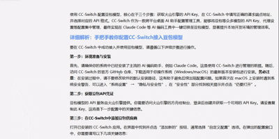
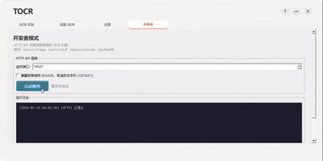

# TurboOCR

<div align="center">

**🚀 Fast, Smart, Ready-to-Use Offline OCR Tool for Windows**

Powered by PP-OCRv6 + Paddle Inference. No internet required. GPU accelerated. Millisecond response.

[](LICENSE)
[]()

[中文文档](README.md)

</div>

---

## 📸 Preview

| Screenshot OCR | Batch OCR |
|:---:|:---:|
|  |  |

| Background OCR | HTTP API Mode |
|:---:|:---:|
|  |  |

## ✨ Features

- **🎯 Three Model Sizes** — tiny (~6MB), small (~31MB), medium (~138MB). Balance speed and accuracy to your needs.
- **⚡ GPU Acceleration** — Paddle Inference + CUDA/cuDNN auto-detection. Falls back to CPU when GPU is incompatible.
- **🖥️ Fully Offline** — All inference runs locally. No internet, data stays private.
- **📋 Multiple OCR Modes**
  - **Screenshot OCR** — Global hotkey (Ctrl+Q) rubber-band capture, millisecond recognition.
  - **Batch OCR** — Multi-file parallel processing, supports images & PDF.
  - **Background OCR** — Silent recognition, auto-copy to clipboard with tray notification.
  - **Clipboard OCR** — Monitors clipboard for images, auto-triggers recognition.
- **📄 PDF Support** — Built-in rendering engine, multi-page parallel OCR.
- **📝 Smart Formatting** — 8 parsers (single paragraph, multi-paragraph, code block, vertical text, etc.).
- **🌐 HTTP API** — Built-in REST server (3 endpoints) for cross-language integration.
- **📊 History** — SQLite persistence. Thumbnails + full images + multi-page data. Click to revisit.
- **🎨 Dark Theme** — Full dark mode support.
- **🔍 QR/Barcode** — ZXing + OpenCV fast pre-check, automatic recognition.
- **🌍 Multi-language** — Runtime translation system (Chinese/English).

## 📦 Download

> Go to [Releases](https://github.com/lazyboooooy/TurboOCR/releases) and grab the portable package. Extract and run — no VC++ Redistributable needed.

| File | Size | Description |
|:---|:---|:---|
| **TurboOCR-v0.3.0-portable.zip** | 1.96 GB | Extract & run (CPU inference) |
| TurboOCR-v0.3.0-portable-cuda.zip | 879 MB | GPU acceleration DLLs (optional, for NVIDIA GPUs) |

**Usage:**
1. Download `TurboOCR-v0.3.0-portable.zip` and extract
2. (Optional) If you have an NVIDIA GPU, download `TurboOCR-v0.3.0-portable-cuda.zip` and drop the DLLs into the extracted folder
3. Run `TurboOCR.exe`

> Qt shared libraries are licensed under LGPLv3.

## 🔧 Build from Source

### Prerequisites

| Tool | Version | Notes |
|:---|:---|:---|
| Visual Studio | 2022+ (v142/v143/v145) | MSVC toolchain |
| CMake | 3.16+ | Build system |
| Qt | 6.8.3 msvc2022_64 | GUI framework |
| Python | 3.8+ | Dependency download script |

### Build Steps

```bash
# 1. Download prebuilt dependencies (3rdparty/ + models/, ~3.4 GB)
python setup_deps.py

# 2. Configure CMake
cmake -B build -DCMAKE_PREFIX_PATH="D:/Qt/6.8.3/msvc2022_64"

# 3. Build
cmake --build build --config Release

# 4. Run
./build/Release/TurboOCR.exe
```

> **Note:** Run from a VS Developer Command Prompt to ensure the MSVC toolchain is in PATH.

### Dependencies

`3rdparty/` (third-party libraries) and `models/` (OCR models) are prebuilt binaries **not tracked in this repository**. Run `python setup_deps.py` to download them from [GitHub Releases](https://github.com/lazyboooooy/TurboOCR/releases).

If you have limited network access, download the `deps-*.zip` files manually and run:
```bash
python setup_deps.py --local ./download-directory
```

## 🏗️ Project Layout

```
TurboOCR/
├── src/
│   ├── main.cpp                Entry point (single-instance lock)
│   ├── main_window.h/.cpp      Main window (frameless, tray, hotkey, clipboard)
│   ├── ocr/engine.h/.cpp       OCR engine wrapper
│   ├── core/
│   │   ├── config_manager      INI config + model size persistence
│   │   ├── logger              Logging system
│   │   ├── ocr_history         SQLite history
│   │   ├── pdf_render          PDF → PNG rendering
│   │   ├── screen_capture      Fullscreen rubber-band capture
│   │   ├── gpu_checker         GPU/CUDA/cuDNN compatibility detection
│   │   ├── qrcode_scanner      QR/barcode scanning
│   │   ├── http_server         REST API server
│   │   ├── theme               Theme management
│   │   └── i18n                Internationalization
│   ├── pages/
│   │   ├── calligraphy_ocr_page  Main OCR page
│   │   ├── batch_page            Batch OCR
│   │   ├── settings_page         Settings page
│   │   └── developer_page        API + log console
│   ├── postprocess/parsers     8 text parsers
│   └── output/formatters       Export formatters
├── ocr_engine/                 PaddleOCR C++ engine
├── models/                     PP-OCRv6 model files
└── resources/                  Icons, translations
```

## 📄 Third-Party Licenses

This project is built upon the following open-source libraries. Thank you to all contributors!

| Library | Version | License | Purpose |
|:---|:---|:---|:---|
| [PaddlePaddle](https://github.com/PaddlePaddle/Paddle) | 3.0.0 | Apache 2.0 | OCR inference engine |
| [OpenCV](https://github.com/opencv/opencv) | 3.4.10 | Apache 2.0 | Image processing |
| [Qt](https://www.qt.io/) | 6.8.3 | LGPLv3 | GUI framework |
| [ZXing-C++](https://github.com/nu-book/zxing-cpp) | 2.2.1 | Apache 2.0 | Barcode scanning |
| [Protobuf](https://github.com/protocolbuffers/protobuf) | - | BSD 3-Clause | Model serialization |
| [gflags](https://github.com/gflags/gflags) | - | BSD 3-Clause | CLI parsing |
| [glog](https://github.com/google/glog) | - | BSD 3-Clause | Logging |
| [Abseil](https://github.com/abseil/abseil-cpp) | - | Apache 2.0 | C++ utility library |
| [oneDNN](https://github.com/oneapi-src/oneDNN) | - | Apache 2.0 | Deep learning acceleration |
| [nlohmann/json](https://github.com/nlohmann/json) | - | MIT | JSON parsing |
| [yaml-cpp](https://github.com/jbeder/yaml-cpp) | - | MIT | YAML parsing |
| [zlib](https://github.com/madler/zlib) | - | zlib License | Compression |
| [Clipper](http://www.angusj.com/delphi/clipper.php) | - | BSL 1.0 | Polygon clipping |
| [xxHash](https://github.com/Cyan4973/xxHash) | - | BSD 2-Clause | Fast hashing |

## 🤝 Contributing

Contributions are welcome! Please follow these steps:

1. Fork the repository
2. Create a feature branch (`git checkout -b feature/amazing-feature`)
3. Commit your changes (`git commit -m 'Add amazing feature'`)
4. Push to the branch (`git push origin feature/amazing-feature`)
5. Open a Pull Request

## ⚠️ Disclaimer

This tool is intended for educational and legitimate use only. Do not use TurboOCR to infringe upon the rights of others.

## 📄 License

TurboOCR is open-sourced under the [Apache License 2.0](LICENSE).

Copyright © 2026 TurboOCR Contributors
